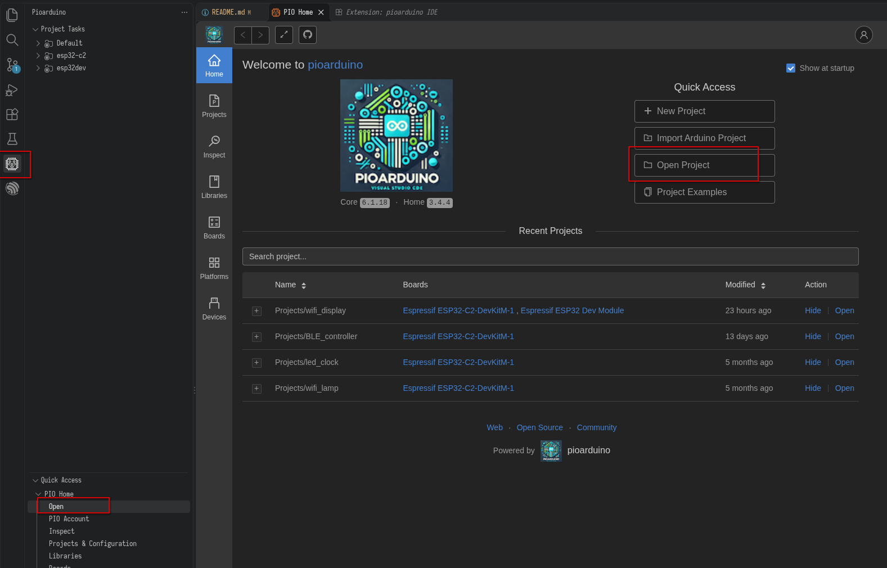
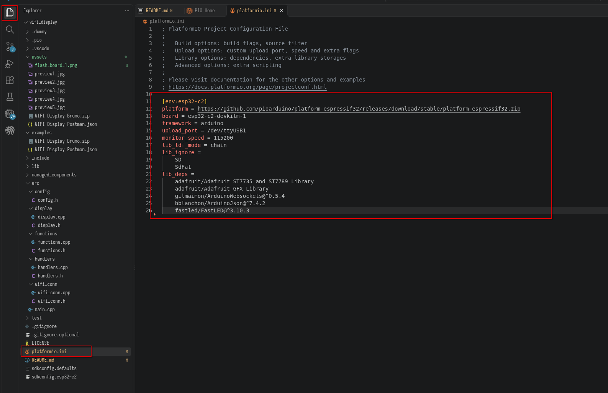
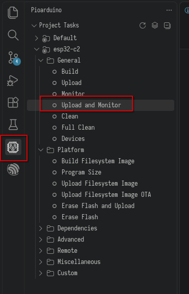

# WiFi-Switch-for-electrical-devices
Small esp8684 based circuit controlling switches via WiFi and physical button

## Table of contents

- [Features](#features)
- [How it works](#how-it-works)
- [Build](#build)
- [Configuration](#configuration)
- [Flash the board](#flash-board)
- [API](#API)

## Features
- Control multiple GPIO outputs via Wi-Fi - HTTP requests
- Physical button control for configured outputs
- Configurable static IP address
- Support for multiple output pins and physical switches
- Deep sleep mode for reduced power consumption
- Automatic sleep when Wi-Fi connection fails
- Configurable button input filtering to prevent false activations

## How it works
    Just send HTTP request with `state` = `on`/`off` and `number` = number of pin on the `OUTPUT_PINS` list (configuration below).
    `curl http://192.168.0.31/switch?state=on&number=0`

## Build

- Connect each output device to its assigned GPIO pin.
- Connect physical buttons between their assigned GPIO pins and GND.
- Power the board using a suitable power supply.
- Make sure all connected components use compatible voltage levels.

## Configuration
### **Open project directory and edit `/src/main.cpp`**

All device settings can be customized directly in the source code before uploading the firmware.

### Power Management

```cpp
#define DEEP_SLEEP_DURATION_NO_WIFI 10
#define DEEP_SLEEP_DURATION 10
```

| Setting | Description |
| --- | --- |
| `DEEP_SLEEP_DURATION_NO_WIFI` | Deep sleep duration in seconds when the device cannot connect to Wi-Fi. |
| `DEEP_SLEEP_DURATION` | Deep sleep duration in seconds during normal power-saving operation. |

Both values are expressed in seconds.

For example, `10` means the device will sleep for 10 seconds.


### Wi-Fi and Network

```cpp
#define CONNECTION_TIMEOUT 5

const char *ssid = "";
const char *password = "";

IPAddress local_IP(192, 168, 0, 31);
IPAddress gateway(192, 168, 0, 1);
IPAddress subnet(255, 255, 255, 0);
IPAddress primaryDNS(1, 1, 1, 1);
IPAddress secondaryDNS(1, 0, 0, 1);
```

| Setting | Description |
| --- | --- |
| `CONNECTION_TIMEOUT` | Maximum time in seconds to wait for a Wi-Fi connection before entering the no-Wi-Fi sleep mode. |
| `ssid` | Name of your Wi-Fi network. |
| `password` | Wi-Fi network password. |
| `local_IP` | Static IP address assigned to the device. Choose an unused address within your local network. |
| `gateway` | IP address of your router, usually `192.168.0.1` or `192.168.1.1`. |
| `subnet` | Network subnet mask. Usually `255.255.255.0`. |
| `primaryDNS` | Primary DNS server. |
| `secondaryDNS` | Secondary DNS server used as a fallback. |

**Important:**

- Make sure `local_IP` is not already assigned to another device.
- `gateway` must match your router's IP address.
- If your router uses DHCP, make sure you disable it for this range of ip addresses so no other device will get the same one.


### Web Server

```cpp
WebServer server(80);
```

The device runs an HTTP web server on port `80`.

You can access it using the device's IP address, for example:

`http://192.168.0.31`

`curl http://192.168.0.31/switch?state=on&number=0` -> turn on first switch

Change the port if you need to use a different one.

### Output Pins

```cpp
const int PIN_COUNT = 5;

const int OUTPUT_PINS[PIN_COUNT] = {2, 3, 18, 19, 20};

bool OUTPUT_STATUS[PIN_COUNT] = {
    false, false, false, false, false
};
```

These settings control the GPIO pins used as outputs.

| Setting | Description |
| --- | --- |
| `PIN_COUNT` | Number of configured output pins. |
| `OUTPUT_PINS` | GPIO numbers assigned as outputs. |
| `OUTPUT_STATUS` | Initial state of each output (`false` = OFF, `true` = ON). |

**Important:**

- The number of elements in `OUTPUT_PINS` and `OUTPUT_STATUS` must match `PIN_COUNT`.
- Only use GPIO pins supported by your board.

Example with three outputs:

```cpp
const int PIN_COUNT = 3;

const int OUTPUT_PINS[PIN_COUNT] = {2, 3, 18};

bool OUTPUT_STATUS[PIN_COUNT] = {
    false, false, true
};
```

### Physical Switches

```cpp
const int SWITCH_COUNT = 2;

const int SWITCH_PINS[SWITCH_COUNT] = {6, 7};
```

These settings configure physical buttons connected to the device.

| Setting | Description |
| --- | --- |
| `SWITCH_COUNT` | Number of physical buttons. |
| `SWITCH_PINS` | GPIO pins connected to the buttons. |

**Important:**

- The number of elements in `SWITCH_PINS` must match `SWITCH_COUNT`.
- The order of `SWITCH_PINS` corresponds to the order of `OUTPUT_PINS`.
- The first switch controls the first output, the second switch controls the second output, and so on.
- Make sure the selected GPIO pins are supported and available on your board.

Example with three buttons and three outputs:

```cpp
const int PIN_COUNT = 3;
const int OUTPUT_PINS[PIN_COUNT] = {2, 3, 18};

const int SWITCH_COUNT = 3;
const int SWITCH_PINS[SWITCH_COUNT] = {6, 7, 10};
```

### Switch Input Filtering

```cpp
const int CONFIRM_THRESHOLD = 3;

unsigned long lastActivitySwitch[SWITCH_COUNT] = {0};
int switchConfirmCount[SWITCH_COUNT] = {0};
```

`CONFIRM_THRESHOLD` controls how many consecutive button checks are required before a button press is accepted.

The firmware checks the button state every 25 milliseconds.

For example:

| Threshold | Approximate confirmation time |
| --- | --- |
| `1` | 25 ms |
| `2` | 50 ms |
| `3` | 75 ms |
| `4` | 100 ms |
| `5` | 125 ms |

Increasing this value makes the input filtering more resistant to electrical interference and unwanted button activations, but also increases the response delay.

**Recommended value:** `3`.

The following variables are internal state trackers. You normally do not need to modify them:

- `lastActivitySwitch` – stores the last recorded activity time for each switch.
- `switchConfirmCount` – stores the number of consecutive checks for each switch.

## Flash board

1. **Install the PlatformIO IDE extension** (`pioarduino IDE`) in Visual Studio Code.

2. **Open your project** in VS Code.

   <p align="center">
     
   </p>

3. **Check the configuration.** Make sure all settings are correct and that `upload_port` points to the port connected to your board.

   <p align="center">
     
   </p>

4. **Flash your board** using the Upload command.

   <p align="center">
     
   </p>


## API

Control GPIO outputs using HTTP GET requests.

```bash
curl "http://192.168.0.31/switch?state=on&number=0"
```

- `state` – Output state: `on` or `off`.
- `number` – Output index, starting from `0`.

Replace the IP address with your device's IP address.